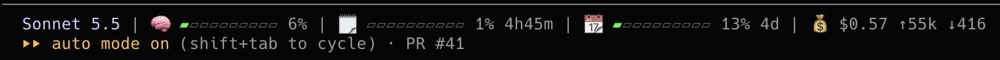

# Claude Settings

This is the repo for the claude settings used across all your platforms. 

## settings.json
Included here is your statusline udpates to see the current model and token usage. 


Change the `statusLine` block in `~/.claude/settings.json` to this:

```
"statusLine": {
  "type": "command",
  "command": "bash ~/.claude/statusline.sh",
  "refreshInterval": 30
}
```
